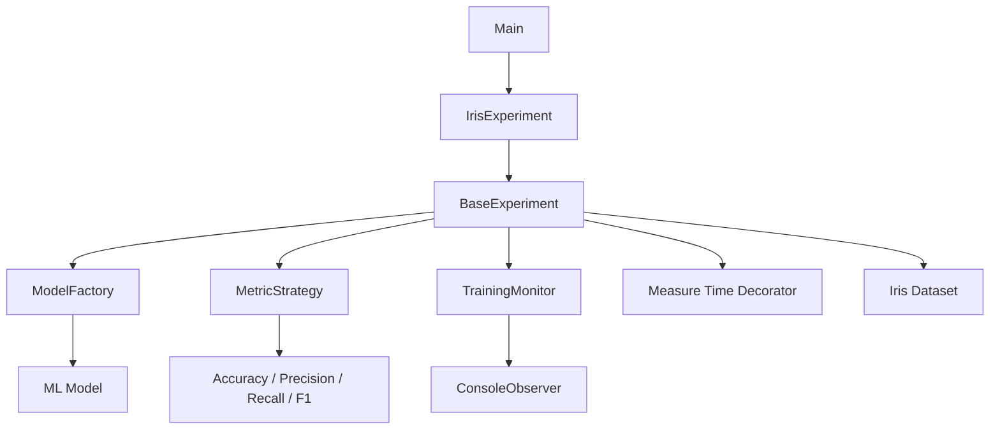

# Napredno programiranje — Filip Starovlah

Ovaj GitHub repozitorijum koristi se za sve mini projekte i zadatke iz predmeta Napredno programiranje.

## Radno okruženje

- Python 3.12 ili noviji
- Visual Studio Code
- Ruff — provjera kvaliteta i formatiranje Python koda
- pytest — automatsko testiranje

## Instalacija

Kloniraj repozitorijum i uđi u njegov direktorijum:

```bash
git clone https://github.com/starovlahfilip/np-Filip-Starovlah.git
cd np-Filip-Starovlah
```

Kreiraj i aktiviraj virtuelno okruženje.

Windows:

```powershell
py -3.12 -m venv .venv
.venv\Scripts\Activate.ps1
```

Instaliraj razvojne alate:

```bash
python -m pip install --upgrade pip
pip install -e ".[dev]"
```

---

## Zadatak 1: Prosječna cijena

Implementirana je funkcija `prosjecna_cijena(cijene)` u fajlu `src/cijene.py`.

Funkcija računa aritmetičku sredinu proslijeđenih cijena.

Pravila:

- Ulaz mora sadržati najmanje jednu cijenu.
- Cijene moraju biti brojevi (`int` ili `float`).
- Negativne cijene nijesu dozvoljene.
- Za prazan skup podiže se `ValueError`.
- Za vrijednosti koje nijesu brojevi podiže se `TypeError`.

Primjer:

```python
from src.cijene import prosjecna_cijena

print(prosjecna_cijena([10, 20, 30]))  # 20.0
```

### AI asistent — upit i uočeni nedostaci

**Upotrijebljeni upit:**

> Napiši Python funkciju `prosjecna_cijena` koja prima kolekciju cijena i vraća njihovu aritmetičku sredinu. Obradi slučaj prazne kolekcije i neispravnih ulaznih podataka. Napiši pytest testove za normalan slučaj, jednu vrijednost, praznu kolekciju, negativnu cijenu i vrijednost pogrešnog tipa. Koristi čitljiv i jednostavan Python kod.

**Uočeni nedostaci i ograničenja generisanog koda:**

- AI ne zna poslovna pravila zadatka ako nijesu precizno navedena. U ovom primjeru pretpostavljeno je da negativne cijene nijesu dozvoljene.
- Nije definisano zaokruživanje rezultata na određeni broj decimala; funkcija vraća standardni Python rezultat dijeljenja.
- Za novčane iznose `float` može dovesti do sitnih grešaka preciznosti. U stvarnoj finansijskoj aplikaciji bolje je razmotriti `decimal.Decimal`.
- Generisani kod i testove treba pregledati i pokrenuti prije predaje.

---

## Zadatak 2: Refaktorisanje sistema hotelskih rezervacija

Cilj zadatka je refaktorisanje početnog monolitnog Python programa za obradu hotelskih rezervacija, uz primjenu principa čistog dizajna.

Program omogućava:

- Učitavanje hotelskih rezervacija.
- Obračun ukupnog prihoda.
- Izračunavanje ukupnog broja noćenja.
- Izračunavanje prosječne vrijednosti rezervacije.
- Identifikovanje skupih rezervacija.

### Primijenjeni principi

**Single Responsibility Principle (SRP)**

Odgovornosti su razdvojene između nekoliko klasa:

- `Rezervacija` – predstavlja podatke o rezervaciji i računa njenu ukupnu cijenu.
- `ListaRezervacija` – učitava rezervacije.
- `KonzolniIzvjestaj` – prikazuje rezultate obrade.
- `ServisRezervacija` – obrađuje rezervacije i računa statističke podatke.

**Dependency Inversion Principle (DIP)**

Za primjenu DIP principa korišćen je Python `Protocol`.

Definisana su dva protokola:

- `IzvorRezervacija` – definiše ugovor za učitavanje rezervacija.
- `Izvjestaj` – definiše ugovor za prikazivanje rezultata.

Servis rezervacija zavisi od definisanih protokola, a ne od konkretnih implementacija. Na taj način moguće je zamijeniti izvor podataka ili način prikazivanja rezultata bez izmjene glavne logike obrade.

### Testiranje

Za automatsko testiranje korišćen je `pytest`.

Implementirana su tri testa:

1. Provjera ukupnog prihoda i broja noćenja.
2. Provjera prepoznavanja skupih rezervacija.
3. Provjera obrade prazne liste rezervacija.

Za testiranje su korišćene klase `FakeIzvor` i `FakeIzvjestaj`, koje simuliraju izvor podataka i prikaz rezultata.

**Rezultat testiranja:**

- 3 uspješna testa za hotelske rezervacije.
- 5 uspješnih testova za prethodni zadatak prosječne cijene.
- Ukupno 8 uspješnih testova.

### AI asistent — upotrijebljeni promptovi i uočeni nedostaci

**Primjeri upotrijebljenih promptova:**

> Kako refaktorisati monolitni Python program za obradu hotelskih rezervacija primjenom SRP principa?

> Kako koristiti Python Protocol za primjenu Dependency Inversion Principle?

> Kako organizovati projekat u zasebne module i klase?

> Napiši pytest testove koristeći fake izvor podataka.

> Objasni grešku koja nastaje prilikom korišćenja relativnih importa u Python paketima.

**Uočeni nedostaci i korekcije generisanog koda:**

- Prilagođena je struktura projekta kako bi se izbjegao konflikt između fajla i paketa sa istim nazivom.
- Ispravljen je način pokretanja programa korišćenjem Python module režima.
- Nakon promjene naziva projektnog foldera, bilo je potrebno ponovo instalirati pytest u virtuelnom okruženju zbog zastarjele putanje izvršnog fajla.
- Rezultati obračuna provjereni su poređenjem sa početnim monolitnim programom.
- Generisani kod i testovi provjereni su praktičnim izvršavanjem.

AI alat korišćen je kao pomoć u istraživanju, razumijevanju principa dizajna i otklanjanju grešaka. Generisani kod je pregledan, prilagođen i testiran tokom izrade projekta.

---

## Pokretanje testova

Za pokretanje svih testova iz glavnog direktorijuma projekta:

```bash
pytest -v
```

## Ruff — provjera i formatiranje

Provjera kvaliteta koda:

```bash
ruff check .
```

Automatsko formatiranje:

```bash
ruff format .
```

## Struktura projekta

```text
np-filip-starovlah/
├── src/
│   ├── __init__.py
│   ├── cijene.py
│   ├── rezervacije_monolitno.py
│   └── rezervacije/
│       ├── __init__.py
│       ├── models.py
│       ├── protocols.py
│       ├── data_source.py
│       ├── reporter.py
│       ├── reservation_service.py
│       └── rezervacije.py
├── tests/
│   ├── test_cijene.py
│   └── test_rezervacije.py
├── .gitignore
├── pyproject.toml
└── README.md
```


---

## Mini projekat 2: mini okvir za ML eksperimente

### Opis projekta

Cilj projekta je razvoj jednostavnog frameworka za izvršavanje i evaluaciju eksperimenata mašinskog učenja. Framework omogućava kreiranje različitih ML modela, izbor evaluacione metrike, praćenje toka treniranja i mjerenje vremena izvršavanja.

Za demonstraciju je korišćen Iris skup podataka iz biblioteke Scikit-learn, koji sadrži podatke o tri vrste cvijeta irisa.

### Korišćeni obrasci dizajna

U projektu je implementirano pet obrazaca dizajna:

1. **Factory Pattern** – klasa `ModelFactory` omogućava kreiranje različitih modela: Logistic Regression, Decision Tree i K-Nearest Neighbors.
2. **Strategy Pattern** – omogućava izbor metrike za evaluaciju modela: Accuracy, Precision, Recall i F1-score.
3. **Observer Pattern** – omogućava praćenje toka eksperimenta i slanje obavještenja o početku i završetku treniranja i evaluacije.
4. **Template Method Pattern** – klasa `BaseExperiment` definiše osnovni redosljed koraka eksperimenta, dok konkretna klasa implementira učitavanje podataka.
5. **Decorator Pattern** – dekorator `measure_time` mjeri vrijeme izvršavanja eksperimenta bez izmjene njegove osnovne logike.

### Struktura projekta

```text
np-filip-starovlah/
│
├── src/
│   ├── __init__.py
│   │
│   ├── cijene.py
│   │
│   ├── rezervacije_monolitno.py
│   │
│   ├── rezervacije/
│   │   ├── __init__.py
│   │   ├── models.py
│   │   ├── protocols.py
│   │   ├── data_source.py
│   │   ├── reporter.py
│   │   ├── reservation_service.py
│   │   └── rezervacije.py
│   │
│   └── ml_eksperimenti/
│       ├── __init__.py
│       ├── model_factory.py
│       ├── strategies.py
│       ├── observers.py
│       ├── experiment.py
│       ├── decorators.py
│       └── main.py
│
├── tests/
│   ├── test_cijene.py
│   ├── test_rezervacije.py
│   └── test_ml_eksperimenti.py
│
├── .gitignore
├── pyproject.toml
└── README.md
```

### Arhitektura i tok izvršavanja



### Pokretanje projekta

Instalacija potrebne biblioteke:

```bash
python -m pip install scikit-learn
```

Pokretanje eksperimenta iz glavnog direktorijuma projekta:

```bash
python -m src.ml_eksperimenti.main
```

Pokretanje testova:

```bash
pytest -v
```

Provjera kvaliteta koda:

```bash
ruff check .
```

### Rezultati eksperimenta

Prilikom testiranja korišćen je Logistic Regression model i Accuracy metrika.

- Skup podataka: Iris
- Model: Logistic Regression
- Accuracy: 0.9667 (96,67%)
- Vrijeme izvršavanja: približno 0.0356 sekundi

Rezultati pokazuju da framework uspješno izvršava eksperiment, trenira model, vrši evaluaciju i prati vrijeme izvršavanja.

### Testiranje

Za provjeru funkcionalnosti implementirano je 10 testova koji obuhvataju:

- Kreiranje modela pomoću Factory obrasca.
- Provjeru ponašanja u slučaju nepoznatog modela.
- Izračunavanje evaluacionih metrika.
- Slanje obavještenja putem Observer obrasca.
- Izvršavanje eksperimenta nad Iris skupom podataka.
- Mjerenje vremena izvršavanja pomoću Decorator obrasca.

Ukupan rezultat testiranja kompletnog repozitorijuma: **17 uspješno izvršenih testova.**

### Korišćenje AI alata

AI alat je korišćen kao podrška tokom razvoja projekta, prvenstveno za istraživanje obrazaca dizajna, razumijevanje njihove primjene u Pythonu, predlaganje strukture projekta i pomoć pri pisanju testova.

Primjeri korišćenih promptova:

- Objasni kako se Factory obrazac može primijeniti za kreiranje različitih ML modela u Pythonu.
- Kako implementirati Strategy obrazac za različite evaluacione metrike mašinskog učenja?
- Objasni Observer obrazac i njegovu primjenu za praćenje toka treniranja modela.
- Kako implementirati Template Method obrazac za definisanje koraka ML eksperimenta?
- Kako pomoću Decorator obrasca mjeriti vrijeme izvršavanja funkcije?
- Predloži pytest testove za provjeru implementiranih obrazaca dizajna.

Predložena rješenja su analizirana, prilagođena strukturi projekta i provjerena kroz izvršavanje testova.
```
